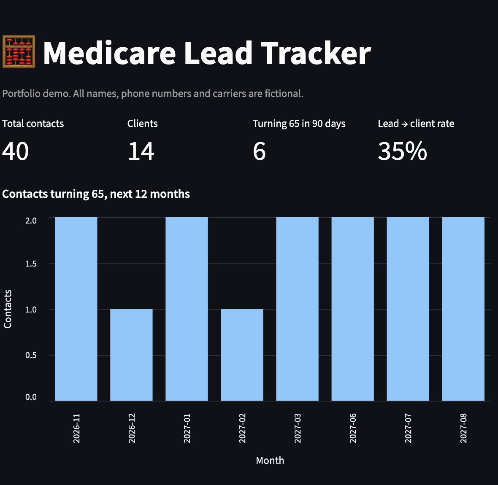

# Medicare Lead Tracker

A Streamlit dashboard I built to run my own licensed Medicare brokerage in New York. It tracks contacts who are about to turn 65, flags who is entering their enrollment window, runs a needs assessment, and ranks carriers by how well they match what a client needs.

> **Privacy note:** This is the portfolio version. **All data is synthetic.** Names, phone numbers and carriers are fictional, and phone numbers use the reserved 555-01XX range. No real client information is in this repository or its history.

<!-- Add a screenshot: save it as screenshot.png in this folder -->


## Features

- **Dashboard:** totals, clients, lead-to-client rate, and a chart of contacts turning 65 over the next 12 months
- **Enrollment alerts:** flags anyone turning 65 in the next 90 days, sorted by urgency
- **Intake form:** validates names and 10-digit phone numbers and normalizes phone format before saving
- **Needs assessment:** dual-eligibility screening plus benefit priorities (dental, vision, Rx, OTC and more)
- **Carrier matching:** scores and ranks carriers by how many priorities they cover and lists what's missing. Dual-eligible clients see D-SNP carriers only
- **Birthday tracker:** upcoming client birthdays, with a callout for same-day calls
- **Editable roster:** edit, add or delete contacts in a table and save back to CSV

## Tech

Python · Streamlit · pandas · CSV storage

## Run it

```bash
pip install -r requirements.txt
python generate_demo_data.py     # creates demo_leads.csv with fictional contacts
streamlit run page_lead_tracker.py
```

## How it works

- Contacts are stored in a CSV and loaded into a pandas DataFrame. On load, the app drops stray columns, fills missing values and parses dates.
- Turning-65 dates and next birthdays handle Feb 29 birthdays correctly in non-leap years.
- Carrier matching is a set intersection between the client's priorities and each carrier's benefits, scored and sorted.

## What I'd build next

- Move from CSV to SQLite or PostgreSQL
- Add encryption at rest and a login, which a real deployment with client data would need
- Add follow-up reminders and a contact history log
